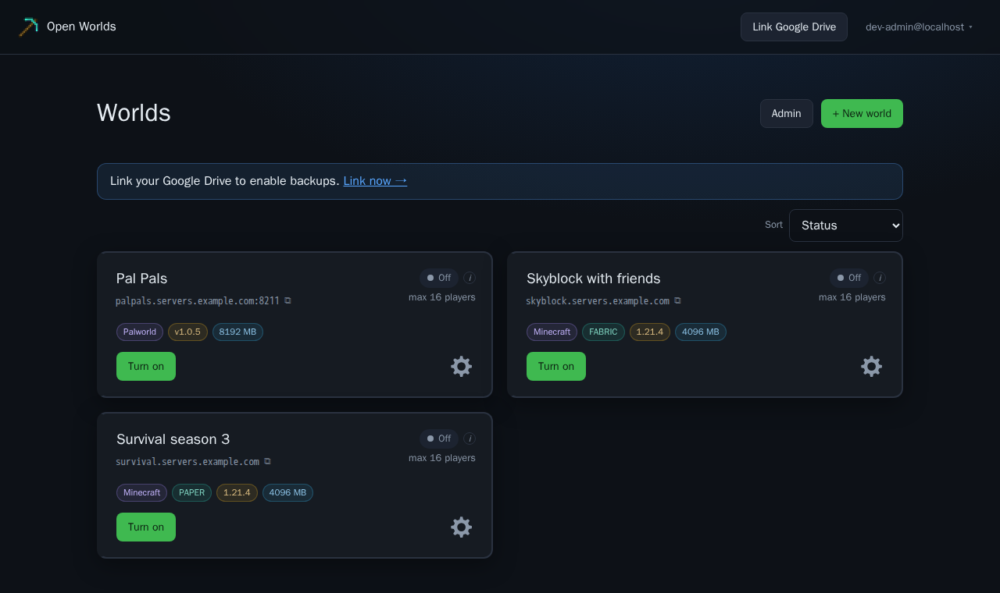

# Open Worlds

A self-hosted platform for running Minecraft and Palworld servers on one machine.
Users sign in with Google, create worlds, and start and stop them from a web UI.
Worlds sleep when idle and wake when a player connects; owners can back them up
to their own Google Drive.



- **Two games, one control plane.** A world's game is a first-class property;
  everything that differs between games lives behind one adapter per game.
- **Sleep and wake.** Idle worlds stop and give their memory back. A Minecraft
  join or a Palworld connect wakes them again, with no owner involved.
- **Closed garden.** Sign-in is by Google; an admin approves each new user.
- **Backups to the owner's Drive**, with the narrow `drive.file` scope, plus
  imports of existing worlds and a curated mod catalog for Minecraft.
- **Locked-down worlds.** World containers run with user-namespace remapping,
  publish no host ports, never touch the Docker socket, and can have their
  outbound traffic restricted to an allow-list.
- **Monitoring included**: VictoriaMetrics and Grafana, with alerts to Discord.

## How it fits together

```
 browser ──HTTPS──▶ outer proxy ──▶ edge (nginx) ──▶ web (SPA)
                                        └──────────▶ api ──▶ Postgres
                                                      │
                                     worker ──────────┤      (backups, imports,
                                                      │       sleep, routes)
                                                      ▼
                                 world manager ──▶ Docker (via socket proxy)
                                                      │
 Minecraft ──TCP 25565──▶ mc-router ──────────▶ world containers
 Palworld  ──UDP 8211+──▶ pal-waker ──────────▶ (one per world)
```

The database is the source of truth; containers are disposable and rebuilt from
it. [`deploy/README.md`](deploy/README.md) has the full architecture, exposure
map and security posture.

| Directory | What it is |
|---|---|
| [`api/`](api/) | Control plane: FastAPI app, worker, world manager (Python, uv) |
| [`web/`](web/) | Single-page app (React, Vite) |
| [`deploy/`](deploy/) | Docker Compose stack, edge proxy, game routers, egress guard, monitoring, host config |

## Quick start

On a Linux host with Docker Engine:

```bash
git clone <this repository> open-worlds
cd open-worlds/deploy
cp .env.example .env && chmod 600 .env    # then fill it in
sudo scripts/host-config.sh --apply
make build && make up && make verify
```

What goes in `.env`, Google sign-in, DNS and TLS are in
[`deploy/README.md`](deploy/README.md#quick-start). Day-to-day operation is in
the [runbook](deploy/RUNBOOK.md).

## Development

The api and web run on a workstation without a Google project; see
[`CONTRIBUTING.md`](CONTRIBUTING.md), which also covers using AI tools here.
[`AGENTS.md`](AGENTS.md) is the briefing for AI coding agents. Security reports
go through [`SECURITY.md`](SECURITY.md).

## License

[MIT](LICENSE).

## History

Open Worlds was developed privately, first as Game Platform, before this
repository started fresh. A few runtime names keep the old one because existing
data depends on them; see "Legacy names" in [`deploy/RUNBOOK.md`](deploy/RUNBOOK.md).
